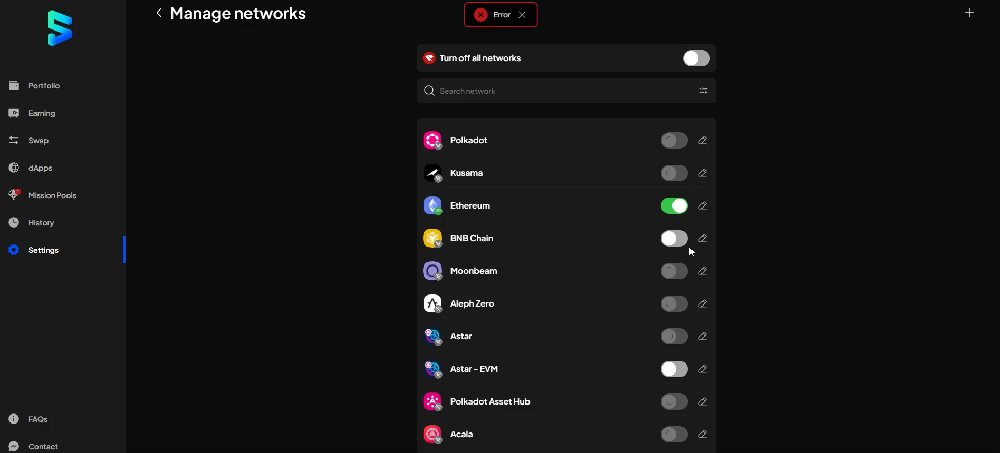
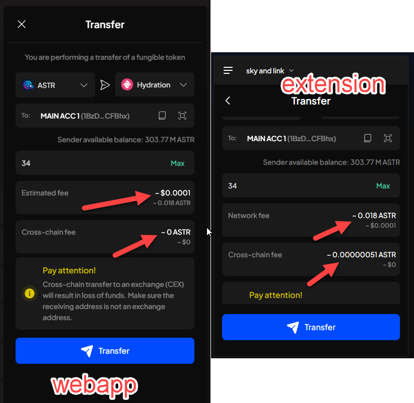
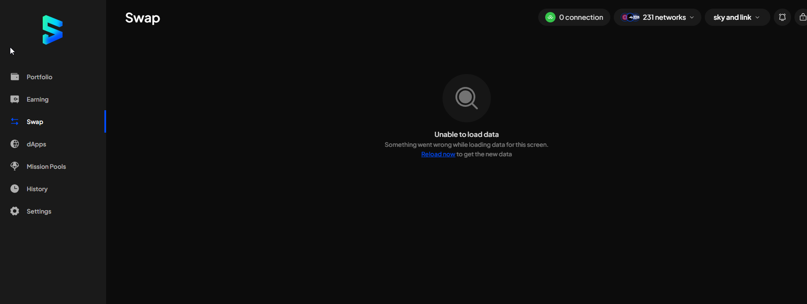

# Manual Test Report — EPIC-42 — 2026-11-03

| Field | Value |
|---|---|
| Epic | EPIC-42 — QA Coverage Tracking |
| Date | 2026-11-03 |
| Tester | MaiThuongNinni |
| Environment | Web App — https://7ae7468d.subwallet-webapp.pages.dev/ |
| Runner | manual (web app) |
| Build under test | PR #5011, Extension code up to v1.3.86 |
| Stories tested | US-42.32 — in progress |
| Total bugs found | 3 |
| P0 | 0 |
| P1 | 2 |
| P2 | 1 |
| P3 | 0 |
| Status | in progress |

---

## US-42.32 — Web App after PR #5011

Started today on the Web App build at `https://7ae7468d.subwallet-webapp.pages.dev/`. Six features checked: the turn-off-all-networks switch (AC-1), 11 of 12 with one substrate-only failure, and the locked balance display (AC-11), the crowdloan removal (AC-8), import from Trust Wallet (AC-2), subnet token names (AC-3) and the asset display name (AC-4), all five passing in full.

### AC results

Turn off all networks (AC-1)

| AC | Description | Result | Notes |
|---|---|---|---|
| AC-1-01 | Manage networks shows a Turn off all networks switch at the top | ✅ Pass | |
| AC-1-02 | With at least one network on, the switch reads off and can be pressed | ✅ Pass | |
| AC-1-03 | With every network off, the switch reads on and is greyed out | ✅ Pass | |
| AC-1-04 | Pressing it opens a confirmation, not an immediate action | ✅ Pass | |
| AC-1-05 | The confirmation wording and the explanation | ✅ Pass | |
| AC-1-06 | Turn off button and a way to cancel; cancelling changes nothing | ✅ Pass | |
| AC-1-07 | Confirming turns off every network | ✅ Pass | substrate and EVM both go off |
| AC-1-08 | With every network off, the screens show an empty state, not an error | ✅ Pass | |
| AC-1-09 | Enabling any one network flips the switch back to off and makes it pressable | ❌ Fail | passes on EVM; substrate stays loading — BUG-42.32-01 |
| AC-1-10 | A failed call says so and leaves the networks as they were | ✅ Pass | |
| AC-1-11 | The switch shows a loading state and cannot be pressed twice | ✅ Pass | |
| AC-1-12 | The state survives a page reload | ✅ Pass | |

11 of 12 pass. Only AC-1-09 fails, and only for substrate — EVM networks re-enable normally.

Turning off is not the problem. Every network, substrate and EVM, goes off correctly, and the switch, the confirmation, the empty states and the reload all behave. The failure is only on the way back up, and only for substrate.

Locked balance (AC-11)

| AC | Description | Result | Notes |
|---|---|---|---|
| AC-11-01 | Token detail opens a Locked details view for a token with locked balance | ✅ Pass | |
| AC-11-02 | The view breaks the locked amount into Governance, Democracy, Reserved and Others, and the parts add up | ✅ Pass | |
| AC-11-03 | Others has a tooltip covering multisig, proxy, identity and the rest | ✅ Pass | |
| AC-11-04 | A token with no locked balance does not offer the view, or shows it empty rather than broken | ✅ Pass | |
| AC-11-05 | The modal is titled Token details for a token and Account details for an account | ✅ Pass | |
| AC-11-06 | Earning position detail shows Total stake, Active stake and Unstaked, and the three agree | ✅ Pass | |
| AC-11-07 | Earning position detail shows Your validators and the nomination info | ✅ Pass | |
| AC-11-08 | The numbers match the chain, checked against an explorer | ✅ Pass | |

All 8 pass. The figures agree with each other inside the app and with the chain — the locked breakdown and the stake figures were both checked against an explorer.

Crowdloan removed (AC-8)

| AC | Description | Result | Notes |
|---|---|---|---|
| AC-8-01 | There is no Crowdloans entry in the side menu | ✅ Pass | |
| AC-8-02 | There is no Crowdloans tab or entry point anywhere in the app | ✅ Pass | |
| AC-8-03 | Opening the old crowdloan URL by hand does not reach a crowdloan screen | ✅ Pass | |
| AC-8-04 | Nothing elsewhere links to it, and no screen breaks where it used to be | ✅ Pass | |

All 4 pass. Crowdloan is gone from the menu and from every other entry point, the old URL no longer lands on a crowdloan screen, and nothing is left broken where it used to sit.

Import from Trust Wallet (AC-2)

| AC | Description | Result | Notes |
|---|---|---|---|
| AC-2-01 | The import account modal offers Import from Trust Wallet as its own option, with the Trust Wallet logo | ✅ Pass | |
| AC-2-02 | Choosing it opens the account type modal first, then the import screen | ✅ Pass | |
| AC-2-03 | The import screen is titled Import from Trust Wallet and asks for the 12-word seed phrase | ✅ Pass | |
| AC-2-04 | The word-count picker offers 12 only — the normal import still offers 12, 15 and 24 | ✅ Pass | |
| AC-2-05 | The screen explains that this creates a solo Polkadot account usable on both SubWallet and Trust Wallet | ✅ Pass | |
| AC-2-06 | It also says that importing the same phrase through Import from seed phrase instead gives a unified account | ✅ Pass | |
| AC-2-07 | A valid 12-word Trust Wallet phrase imports, and the address matches the one Trust Wallet shows | ✅ Pass | |
| AC-2-08 | The imported account is a solo Polkadot account, not a unified one — account details say so | ✅ Pass | |
| AC-2-09 | Pasting a general seed phrase into this screen warns the user rather than importing silently | ✅ Pass | |
| AC-2-10 | A phrase with an invalid word is refused with a clear message | ✅ Pass | |
| AC-2-11 | Importing the same phrase a second time is handled — no duplicate account created silently | ✅ Pass | |
| AC-2-12 | The imported account can sign a transaction | ✅ Pass | |
| AC-2-13 | Back from the import screen returns to the Trust Wallet modal, not to the general import modal | ✅ Pass | |
| AC-2-14 | The same phrase imported through the normal seed-phrase option still gives a unified account | ✅ Pass | |

All 14 pass. The option is its own entry with the Trust Wallet logo, the screen takes 12 words only while the normal import keeps 12, 15 and 24, and the address matches what Trust Wallet shows. The account comes in as a solo Polkadot account and signs, a general phrase is warned about rather than imported silently, an invalid word is refused, and the same phrase through the normal seed-phrase option still gives a unified account.

Subnet token names (AC-3)

| AC | Description | Result | Notes |
|---|---|---|---|
| AC-3-01 | A Bittensor subnet token shows its subnet name in the token list, not a bare symbol | ✅ Pass | |
| AC-3-02 | The same name shows on token detail and in the balance rows | ✅ Pass | |
| AC-3-03 | Two subnets that share a symbol are told apart on screen | ✅ Pass | |
| AC-3-04 | A token that is not a subnet token is unaffected | ✅ Pass | |

All 4 pass. Subnet tokens carry their subnet name in the list, on token detail and in the balance rows, two subnets sharing a symbol can be told apart, and ordinary tokens are left as they were.

Asset display name (AC-4)

| AC | Description | Result | Notes |
|---|---|---|---|
| AC-4-01 | The token list shows the asset display name | ✅ Pass | |
| AC-4-02 | Token detail and the desktop detail list show the same name | ✅ Pass | |
| AC-4-03 | Manage tokens shows it, and searching by that name finds the token | ✅ Pass | |
| AC-4-04 | The token picker on Send shows it | ✅ Pass | |
| AC-4-05 | The token selector in the Receive modal shows it | ✅ Pass | |
| AC-4-06 | Buy token shows it | ✅ Pass | |
| AC-4-07 | The toggle rows in Manage tokens show it | ✅ Pass | |
| AC-4-08 | An asset with no display name falls back to its symbol rather than showing blank | ✅ Pass | |

All 8 pass. The display name is used on every screen that shows a token — the list, token detail and the desktop detail list, Manage tokens and its toggle rows, the Send picker, the Receive selector and Buy token — search by that name finds the token, and an asset with no display name falls back to its symbol instead of going blank.

Bittensor staked swap balance (AC-12) — blocked

| AC | Description | Result | Notes |
|---|---|---|---|
| AC-12-01 | Swapping a Bittensor token shows Staked balance alongside the available balance | ⛔ Blocked | BUG-42.32-03 |
| AC-12-02 | The staked balance has a tooltip saying the staked amount is used to perform the swap | ⛔ Blocked | BUG-42.32-03 |
| AC-12-03 | The available balance has its own tooltip, Available balance for swap | ⛔ Blocked | BUG-42.32-03 |
| AC-12-04 | A swap that draws on the staked balance quotes and completes, and the position drops by what was swapped | ⛔ Blocked | BUG-42.32-03 |
| AC-12-05 | A swap larger than staked plus available is refused before submitting | ⛔ Blocked | BUG-42.32-03 |
| AC-12-06 | A non-Bittensor swap shows no staked balance row and behaves as before | ⛔ Blocked | BUG-42.32-03 |

All 6 blocked. The Swap screen never loads, so none of these can be reached — there is no swap form to open, no token to pick and no quote to read. Nothing here is known to be broken or working; it is untested.

### Bugs

| ID | Title | Steps to reproduce | Actual | Expected | Severity | Status | Screenshot |
|---|---|---|---|---|---|---|---|
| BUG-42.32-01 | Substrate networks stay on a spinning toggle when turned back on after Turn off all networks | Settings → Manage networks → press Turn off all networks and confirm → every network goes off → turn Ethereum back on → then turn Polkadot, Kusama, Moonbeam, Aleph Zero, Astar, Polkadot Asset Hub and Acala back on | - EVM networks turn on right away - Every substrate network sticks on a spinning toggle and never finishes, with an Error toast at the top of the screen - Switching that network to a different valid RPC does turn it on | Each substrate network turns back on the same as an EVM one — the toggle settles and the chain connects, without having to change the RPC | P1 | todo |  |
| BUG-42.32-02 | Web App rounds the cross-chain fee to 0 ASTR on an XCM transfer, and labels the network fee differently from the Extension | Open the Web App and the Extension side by side on the same account → Send → choose ASTR, destination chain Hydration → paste the same recipient address into both → enter the same amount, 34 → compare the two fee rows | - Web App shows Cross-chain fee `~ 0 ASTR` / `~ $0` - Extension shows `~ 0.00000051 ASTR` / `~ $0` for the same transfer - Web App names the first row Estimated fee, the Extension names it Network fee — the value is the same, 0.018 ASTR - Web App puts the token amount under the dollar figure, the Extension puts it above | Both clients show the same cross-chain fee for the same transfer — `~ 0.00000051 ASTR`, not rounded away to 0 — and use the same row label for the network fee | P2 | todo |  |
| BUG-42.32-03 | Swap screen will not load on the Web App — Unable to load data, and Reload now does not recover it | Open the Web App → click Swap in the side menu | - The screen shows *Unable to load data* with *Something went wrong while loading data for this screen* and a *Reload now* link - Clicking *Reload now* leaves the same error — the screen never loads - No swap form, no token pickers, nothing to interact with - The header reads *0 connection* while *231 networks* are enabled | The Swap screen loads its form and token pickers so a swap can be quoted and submitted; if data genuinely fails to load, *Reload now* recovers it | P1 | todo |  |

This one takes a whole feature out. The screen is not slow or partly drawn — it renders the empty-state error instead of the swap form, so there is no form to fill, no token to pick and no quote to read. *Reload now* is the app's own recovery link and it does not work, which means a user who hits this has nothing left to try on that screen.

The header saying *0 connection* while *231 networks* are enabled is worth passing on with the bug. Whether the swap screen fails because no chain is connected, or both symptoms come from the same cause, is for the developer to say — but a swap needs chain data, and the count being zero is the kind of detail that shortens the hunt. Note that BUG-42.32-01 also leaves networks disconnected after a turn-off-all; whether this session had been through that is worth stating when the issue is filed.

P1: an entire top-level feature is unusable and the in-app recovery does not help. It blocks AC-12 in full, all six lines, and those are recorded as blocked rather than failed — the code behind them has not been reached, so nothing is known about it either way.

The fee is the real defect; the labels are a second, smaller thing in the same screenshot. `0.00000051 ASTR` is not zero, and the Web App has the room to show it — it prints eight decimals for the ASTR amount elsewhere on the same screen. Showing `0` where the Extension shows a real figure makes the two clients disagree about what the transfer costs, and a user who checks one against the other cannot tell which is right. Rounding to zero also hides the fee entirely on chains where the destination fee is small but not negligible.

The row label is separate: the Web App calls the first row *Estimated fee* while the Extension calls it *Network fee*, for the same 0.018 ASTR. The Web App also stacks the two figures the other way round, dollars above token. Same feature, same release, two different presentations — worth raising with the developer even though nothing is wrong with the number.

P2 rather than P1: nothing is blocked and no funds are at risk, but the number shown is wrong and the two clients contradict each other.

Changing the RPC is the key detail. Enabling the chain is not broken — the chain comes up as soon as it is pointed at a different valid endpoint. What does not work is re-enabling on the endpoint already selected, which is the one *Turn off all networks* just disconnected from. So the fault is in the reconnect to an endpoint that was torn down, not in the enable path and not in the switch.

That also explains why only substrate is affected: EVM chains talk over plain HTTP requests with nothing to tear down, while substrate holds an open WebSocket that *turn off all* closes. The provider instance appears not to be rebuilt on a re-enable, so the chain waits forever on a socket that is gone, while choosing another RPC forces a fresh one.

A workaround exists for users who hit this — switch the RPC — but it is not discoverable, and the Error toast gives no hint. Keeping P1.

Worth putting in the issue when one is filed: the console output on a failing enable, and whether a page reload also brings the chains back.

## Summary

Session open. Web App only today — US-42.32, the first run on the build from PR #5011.

BUG-42.32-01 found on the first feature checked. After *Turn off all networks*, substrate networks stay on a spinning toggle when turned back on, while EVM networks enable normally. Pointing the chain at a different valid RPC does enable it, so the fault is the reconnect to the endpoint that was just torn down, not the enable itself. P1, failing AC-1-09.

BUG-42.32-02 found while comparing the Web App against the Extension on the same XCM transfer. The Web App rounds the cross-chain fee to `~ 0 ASTR` where the Extension shows `~ 0.00000051 ASTR`, and labels the network fee row differently. P2 — nothing blocked, but the number is wrong and the two clients disagree. AC-13 as a whole has not been run yet; this came out of a side-by-side check.

BUG-42.32-03 takes the Swap screen out entirely. It renders *Unable to load data* instead of the swap form and the in-app *Reload now* link does not recover it, so there is nothing a user can do on that screen. P1. It blocks AC-12 in full — all six lines are recorded as blocked, not failed, because the code behind them was never reached.

AC-1 stands at 11 of 12 pass — only AC-1-09 fails, and only for substrate. Five features pass in full: locked balance 8 of 8 including the cross-check against an explorer, crowdloan removed 4 of 4, import from Trust Wallet 14 of 14, subnet token names 4 of 4 and the asset display name 8 of 8. AC-12 is blocked in full, 6 lines. 49 of 112 AC settled, 6 blocked, the rest not run.
