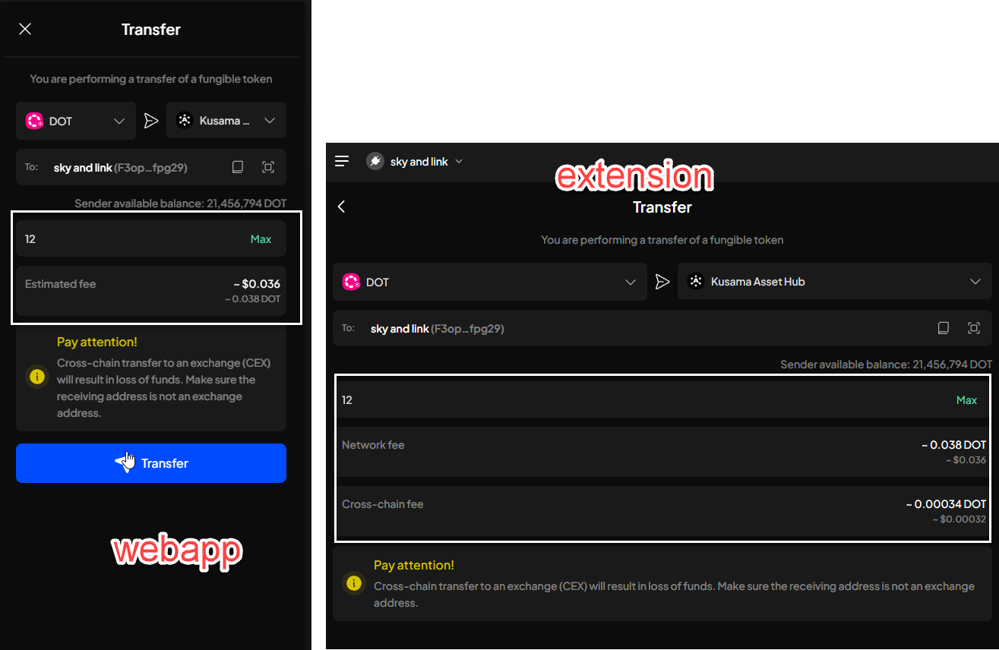

# Manual Test Report — EPIC-42 — 2026-11-03

| Field | Value |
|---|---|
| Epic | EPIC-42 — QA Coverage Tracking |
| Date | 2026-11-03 |
| Tester | MaiThuongNinni |
| Environment | Web App — https://7ae7468d.subwallet-webapp.pages.dev/ |
| Runner | manual (web app) |
| Build under test | PR #5011, Extension code up to v1.3.86 |
| Stories tested | US-42.32 — in progress |
| Total bugs found | 3 |
| P0 | 0 |
| P1 | 3 |
| P2 | 0 |
| P3 | 0 |
| Status | done |

---

## US-42.32 — Web App after PR #5011

First run on the Web App build at `https://7ae7468d.subwallet-webapp.pages.dev/` after PR #5011. Six features checked today, out of the ten this story covers.

### AC results

| AC | Description | Result | Notes |
|---|---|---|---|
| AC-1-01 | Manage networks shows a Turn off all networks switch at the top | ✅ Pass | |
| AC-1-02 | With at least one network on, the switch reads off and can be pressed | ✅ Pass | |
| AC-1-03 | With every network off, the switch reads on and is greyed out | ✅ Pass | |
| AC-1-04 | Pressing it opens a confirmation, not an immediate action | ✅ Pass | |
| AC-1-05 | The confirmation wording and the explanation | ✅ Pass | |
| AC-1-06 | Turn off button and a way to cancel; cancelling changes nothing | ✅ Pass | |
| AC-1-07 | Confirming turns off every network | ✅ Pass | substrate and EVM both go off |
| AC-1-08 | With every network off, the screens show an empty state, not an error | ✅ Pass | |
| AC-1-09 | Enabling any one network flips the switch back to off and makes it pressable | ❌ Fail | passes on EVM; substrate stays loading — BUG-42.32-01 |
| AC-1-10 | A failed call says so and leaves the networks as they were | ✅ Pass | |
| AC-1-11 | The switch shows a loading state and cannot be pressed twice | ✅ Pass | |
| AC-1-12 | The state survives a page reload | ✅ Pass | |
| AC-11-01 | Token detail opens a Locked details view for a token with locked balance | ✅ Pass | |
| AC-11-02 | The view breaks the locked amount into Governance, Democracy, Reserved and Others, and the parts add up | ✅ Pass | |
| AC-11-03 | Others has a tooltip covering multisig, proxy, identity and the rest | ✅ Pass | |
| AC-11-04 | A token with no locked balance does not offer the view, or shows it empty rather than broken | ✅ Pass | |
| AC-11-05 | The modal is titled Token details for a token and Account details for an account | ✅ Pass | |
| AC-11-06 | Earning position detail shows Total stake, Active stake and Unstaked, and the three agree | ✅ Pass | |
| AC-11-07 | Earning position detail shows Your validators and the nomination info | ✅ Pass | |
| AC-11-08 | The numbers match the chain, checked against an explorer | ✅ Pass | |
| AC-8-01 | There is no Crowdloans entry in the side menu | ✅ Pass | |
| AC-8-02 | There is no Crowdloans tab or entry point anywhere in the app | ✅ Pass | |
| AC-8-03 | Opening the old crowdloan URL by hand does not reach a crowdloan screen | ✅ Pass | |
| AC-8-04 | Nothing elsewhere links to it, and no screen breaks where it used to be | ✅ Pass | |
| AC-2-01 | The import account modal offers Import from Trust Wallet as its own option, with the Trust Wallet logo | ✅ Pass | |
| AC-2-02 | Choosing it opens the account type modal first, then the import screen | ✅ Pass | |
| AC-2-03 | The import screen is titled Import from Trust Wallet and asks for the 12-word seed phrase | ✅ Pass | |
| AC-2-04 | The word-count picker offers 12 only — the normal import still offers 12, 15 and 24 | ✅ Pass | |
| AC-2-05 | The screen explains that this creates a solo Polkadot account usable on both SubWallet and Trust Wallet | ✅ Pass | |
| AC-2-06 | It also says that importing the same phrase through Import from seed phrase instead gives a unified account | ✅ Pass | |
| AC-2-07 | A valid 12-word Trust Wallet phrase imports, and the address matches the one Trust Wallet shows | ✅ Pass | |
| AC-2-08 | The imported account is a solo Polkadot account, not a unified one — account details say so | ✅ Pass | |
| AC-2-09 | Pasting a general seed phrase into this screen warns the user rather than importing silently | ✅ Pass | |
| AC-2-10 | A phrase with an invalid word is refused with a clear message | ✅ Pass | |
| AC-2-11 | Importing the same phrase a second time is handled — no duplicate account created silently | ✅ Pass | |
| AC-2-12 | The imported account can sign a transaction | ✅ Pass | |
| AC-2-13 | Back from the import screen returns to the Trust Wallet modal, not to the general import modal | ✅ Pass | |
| AC-2-14 | The same phrase imported through the normal seed-phrase option still gives a unified account | ✅ Pass | |
| AC-3-01 | A Bittensor subnet token shows its subnet name in the token list, not a bare symbol | ✅ Pass | |
| AC-3-02 | The same name shows on token detail and in the balance rows | ✅ Pass | |
| AC-3-03 | Two subnets that share a symbol are told apart on screen | ✅ Pass | |
| AC-3-04 | A token that is not a subnet token is unaffected | ✅ Pass | |
| AC-4-01 | The token list shows the asset display name | ✅ Pass | |
| AC-4-02 | Token detail and the desktop detail list show the same name | ✅ Pass | |
| AC-4-03 | Manage tokens shows it, and searching by that name finds the token | ✅ Pass | |
| AC-4-04 | The token picker on Send shows it | ✅ Pass | |
| AC-4-05 | The token selector in the Receive modal shows it | ✅ Pass | |
| AC-4-06 | Buy token shows it | ✅ Pass | |
| AC-4-07 | The toggle rows in Manage tokens show it | ✅ Pass | |
| AC-4-08 | An asset with no display name falls back to its symbol rather than showing blank | ✅ Pass | |
| AC-12-01 | Swapping a Bittensor token shows Staked balance alongside the available balance | ⛔ Blocked | BUG-42.32-03 |
| AC-12-02 | The staked balance has a tooltip saying the staked amount is used to perform the swap | ⛔ Blocked | BUG-42.32-03 |
| AC-12-03 | The available balance has its own tooltip, Available balance for swap | ⛔ Blocked | BUG-42.32-03 |
| AC-12-04 | A swap that draws on the staked balance quotes and completes, and the position drops by what was swapped | ⛔ Blocked | BUG-42.32-03 |
| AC-12-05 | A swap larger than staked plus available is refused before submitting | ⛔ Blocked | BUG-42.32-03 |
| AC-12-06 | A non-Bittensor swap shows no staked balance row and behaves as before | ⛔ Blocked | BUG-42.32-03 |
| AC-13-01 | A cross-chain transfer shows Network fee and Cross-chain fee as separate rows, not one combined number | ❌ Fail | DOT → Kusama Asset Hub shows one Estimated fee row only — BUG-42.32-02 |
| AC-13-07 | The fee figures match what the balances actually move by | ❌ Fail | ASTR → Hydration rounds the cross-chain fee to 0 — BUG-42.32-02 |

### Bugs

| ID | Title | Steps to reproduce | Actual | Expected | Severity | Status | Screenshot |
|---|---|---|---|---|---|---|---|
| BUG-42.32-01 | Substrate networks stay on a spinning toggle when turned back on after Turn off all networks | Settings → Manage networks → press Turn off all networks and confirm → every network goes off → turn Ethereum back on → then turn Polkadot, Kusama, Moonbeam, Aleph Zero, Astar, Polkadot Asset Hub and Acala back on | - EVM networks turn on right away - Every substrate network sticks on a spinning toggle and never finishes, with an Error toast at the top of the screen - Switching that network to a different valid RPC does turn it on | Each substrate network turns back on the same as an EVM one — the toggle settles and the chain connects, without having to change the RPC | P1 | todo |  |
| BUG-42.32-02 | Fee rows on a cross-chain transfer are wrong on the Web App — values in the wrong position, and on some routes the cross-chain fee row is missing altogether | Open the Web App and the Extension side by side on the same account, and compare the fee rows on the same transfer. Case 1 — Send ASTR to Hydration, amount 34. Case 2 — Send DOT to Kusama Asset Hub, amount 12. | Case 1 — the Web App shows two rows but the values are the wrong way round: *Estimated fee* reads `~ $0.0001` large with `~ 0.018 ASTR` small underneath, where the Extension shows `~ 0.018 ASTR` large with `~ $0.0001` underneath. The cross-chain fee reads `~ 0 ASTR` against the Extension's `~ 0.00000051 ASTR`. Case 2 — the Web App shows one row only, *Estimated fee* `~ $0.036` / `~ 0.038 DOT`. There is no *Network fee* row and no *Cross-chain fee* row. The Extension shows both: *Network fee* `~ 0.038 DOT` and *Cross-chain fee* `~ 0.00034 DOT`. | Both clients show the same two rows on a cross-chain transfer, *Network fee* and *Cross-chain fee*, each with the token amount as the main figure and the dollar value underneath, and the same values — including a cross-chain fee that is not rounded away to 0 | P1 | todo |   |
| BUG-42.32-03 | Swap screen will not load on the Web App — Unable to load data, and Reload now does not recover it | Open the Web App → click Swap in the side menu | - The screen shows *Unable to load data* with *Something went wrong while loading data for this screen* and a *Reload now* link - Clicking *Reload now* leaves the same error — the screen never loads - No swap form, no token pickers, nothing to interact with - The header reads *0 connection* while *231 networks* are enabled | The Swap screen loads its form and token pickers so a swap can be quoted and submitted; if data genuinely fails to load, *Reload now* recovers it | P1 | todo |  |

## Summary

Three bugs logged, all P1. BUG-42.32-01, substrate networks will not re-enable after Turn off all networks while EVM ones do — switching to another valid RPC does enable them. BUG-42.32-02, the cross-chain fee rows: DOT to Kusama Asset Hub shows no cross-chain fee at all, and ASTR to Hydration rounds it to 0 and leads with the dollar value instead of the token amount. BUG-42.32-03, the Swap screen does not load and Reload now does not recover it.

58 of 112 AC run today — 49 pass, 3 fail, 6 blocked.

Five features pass in full: import from Trust Wallet 14 of 14, locked balance 8 of 8 including a cross-check against an explorer, asset display name 8 of 8, crowdloan removed 4 of 4, subnet token names 4 of 4. Turn off all networks is 11 of 12, failing only AC-1-09 and only on substrate.

AC-12, the Bittensor staked swap balance, is blocked in full by BUG-42.32-03 — recorded as blocked rather than failed because the Swap screen never loaded, so the code behind those six lines was never reached.

AC-13-01 and AC-13-07 fail on BUG-42.32-02, found by comparing the Web App against the Extension side by side. The other five lines of AC-13 have not been run.

Not started: nested NFT, alpha token transfer between validators, earning terms i18n, translation keys, chain enabling from a token screen, NFT without `tokenOfOwnerByIndex`, and the regression and fresh/returning-user runs.
